# Kütüphane Ödünç Sistemi ve Öneri Motoru Tasarım Belgesi
| Süre     | Ne anlatılacak?                                                        | Kim anlatacak?         | Görev                | Gösterilecek yer                  |
| -------- | ---------------------------------------------------------------------- | ---------------------- | -------------------- | --------------------------------- |
| 3 dakika | Gereksinimler ve SRS belgesindeki ilgili bölümler                      | Remziye Ersun          | Arayüz               | SRS.md                            |
| 2 dakika | Veritabanı tasarımı, sıralama diyagramı, ER diyagramı ve 3NF gerekçesi | Ümmügülsüm Kitapçıoğlu | Veritabanı görevlisi | tasarım.md, 3. ve 4. bölümler     |
| 2 dakika | Mimari, temel sınıflar, tasarım desenleri ve gerekçeleri               | Gizem Naz Karasu       | Mimarlık             | tasarım.md, 1., 2. ve 5. bölümler |

## 1. Mimari

Kütüphane Ödünç Sistemi ve Öneri Motoru, katmanlı mimari kullanılarak geliştirilecektir. Kodlar, üstlendikleri görevlere göre ayrılacak; isteklerin karşılanması, iş kurallarının uygulanması, veri saklama ve ekran gösterimi farklı katmanlarda gerçekleştirilecektir.

| Katman | Görevi | Kütüphane sistemindeki örneği |
|---|---|---|
| Router | Gelen isteği ilgili Controller metoduna yönlendirir. | Ödünç verme isteğini LoanController'a iletir. |
| Controller | İstek bilgilerini alır, servisi çağırır ve gösterilecek görünümü seçer. | LoanController, üye ve kopya bilgilerini LoanService'e gönderir. |
| Service | İş kurallarını ve algoritmaları uygular. | LoanService, üyenin 5 kitap limitini ve kopyanın müsaitliğini kontrol eder. |
| Repository | Verileri okur ve kaydeder. | LoanRepository, ödünç kaydını saklar. |
| Model | Varlıklara ait bilgileri taşır. | Book kitap bilgilerini, Loan ödünç bilgilerini taşır. |
| View | Sonucu kullanıcıya gösterir. | Ödünç işleminin başarılı olduğunu veya hata nedenini gösterir. |

Controller yalnızca Service katmanını çağıracak, doğrudan veri erişimi yapmayacaktır. Service iş kurallarını uygulayacak; Repository ise veri okuma ve yazma işlemlerinden sorumlu olacaktır. Model veritabanına erişmeyecek, View iş kuralı veya hesaplama içermeyecektir.

### Klasör Yapısı

| Klasör veya dosya | Kullanım amacı |
|---|---|
| public/ | Uygulamanın giriş noktası olan index.php ile CSS, JavaScript ve görselleri içerir. |
| src/Controller/ | Kullanıcı isteklerini karşılayan sınıfları içerir. |
| src/Service/ | Ödünç verme, rezervasyon kuyruğu, ceza hesabı ve öneri algoritmasını içerir. |
| src/Repository/ | Veri erişim arayüzlerini ve bunların JSON ile MySQL uygulamalarını içerir. |
| src/Model/ | Kitap, üye, kitap kopyası ve ödünç kaydı gibi varlık sınıflarını içerir. |
| views/ | Kullanıcıya gösterilecek HTML sayfa şablonlarını içerir. |
| database/ | Veritabanı şeması ve örnek veri oluşturma betiklerini içerir. |
| tests/ | İş kurallarının doğruluğunu kontrol eden otomatik testleri içerir. |
| docs/ | SRS, tasarım belgesi, ekran taslakları ve yapay zekâ günlüğünü içerir. |
| storage/ | JSON dosyaları gibi yerel çalışma verilerini içerir. |
| composer.json | PHP gereksinimini, paketleri ve otomatik yükleme ayarını tanımlar. |
| composer.lock | Kurulan paketlerin sürümlerini sabitler. |
| .gitignore | Git deposuna gönderilmeyecek dosya ve klasörleri belirtir. |
| README.md | Projenin amacını, kurulumunu ve çalıştırma adımlarını açıklar. |

Tarayıcıdan yalnızca public/ klasörüne erişilebilecektir. Böylece kaynak kodlar, proje belgeleri ve yerel veri dosyaları doğrudan web erişimine açılmayacaktır.

### Katman Şeması

Sistem; üye, kütüphaneci ve sistem yöneticisinin isteklerini aynı katmanlı yapı üzerinden işleyecektir. Her modülün Controller sınıfı isteği karşılayacak, Service sınıfı iş kurallarını uygulayacak ve Repository arayüzleri veri erişimini sağlayacaktır.

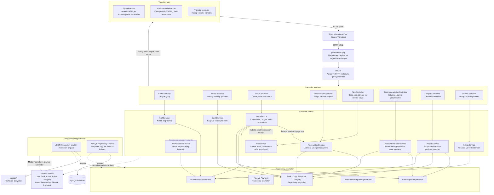

### Katmanlar Arasındaki İşleyiş

Controller, HTTP isteğindeki verileri alır ve uygun Service metodunu çağırır. Service; yetkilendirme, ödünç limiti, rezervasyon sırası ve ceza hesabı gibi kuralları uygular. Veri okumak veya kaydetmek gerektiğinde Repository arayüzlerine başvurur. Sonuç Controller'a döner ve View tarafından kullanıcıya gösterilir.

Örneğin bir kitap iade edildiğinde LoanService, ödünç kaydını kapatır; FineService aracılığıyla gecikme cezasını hesaplar ve ReservationService aracılığıyla uygun kopyanın sıradaki üyeye ayrılmasını sağlar. Verilerin birlikte ve tutarlı güncellenmesi için MySQL aşamasında bu işlem tek transaction kapsamında yürütülecektir.

### Veri Erişimi ve Bağımlılık Kuralları

- Controller, Repository veya veritabanına doğrudan erişmez.
- Service, HTTP form verilerini doğrudan okumaz ve HTML üretmez.
- Repository, iş kurallarını belirlemez; veri okuma ve yazma işlemlerini yürütür.
- Model sınıfları veriyi taşır; dosya veya veritabanı bağlantısı kurmaz.
- View, kendisine verilen bilgileri gösterir ve kullanıcıdan gelen metinleri HTML çıktısında güvenli biçimde kaçışlar.
- Rol ve kayıt sahipliği kontrolleri sunucu tarafında uygulanır; yalnızca düğmeleri gizlemekle yetkilendirme sağlanmaz.
- JSON ve MySQL uygulamaları aynı Repository arayüzlerini kullanır. Kullanılacak uygulama başlangıçta seçilerek servislere verilir.
- Şemadaki düz oklar istek, veri akışı veya kullanım ilişkisini; kesikli oklar arayüz uygulamasını ve Model kullanımını gösterir. Ayrıntılı sınıf ilişkileri sınıf diyagramında tanımlanacaktır.

## 2. Sınıf Diyagramı

### 2.1. Temel Model Sınıfları

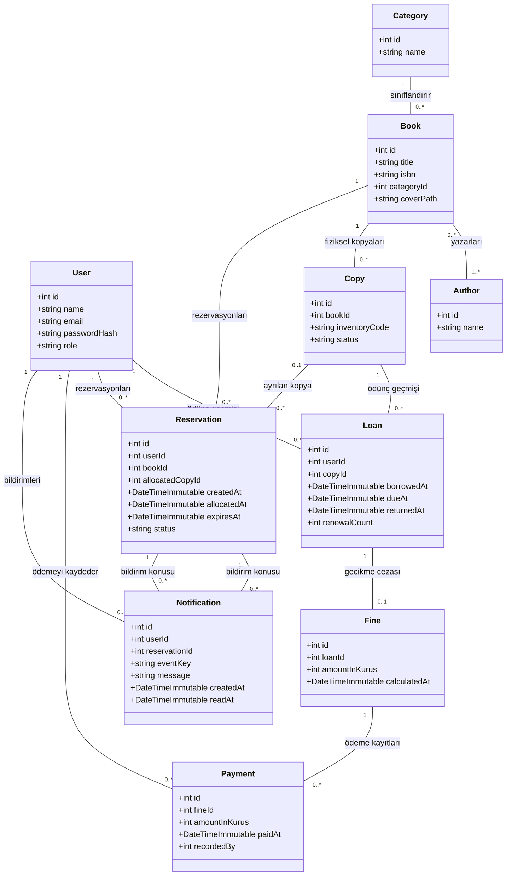

### 2.2. Katmanlar ve Repository Deseni

Controller sınıfları kullanıcı isteklerini karşılar ve ilgili Service sınıfını çağırır. Service sınıfları iş kurallarını uygular; veri okumak ve kaydetmek için Repository arayüzlerini kullanır.

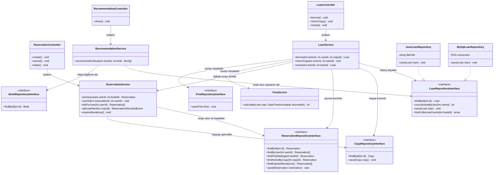

#### Bağlantıların Açıklaması

LoanController, ödünç verme, iade ve uzatma isteklerini LoanService'e iletir.
- LoanService; işlem yetkisini, üyenin beş kitap limitini ve kopyanın müsaitliğini kontrol eder. Başka üyeye ayrılmış kopyanın ödünç verilmesini engeller.
- İade sırasında FineService cezayı hesaplar; LoanService ceza kaydını saklar ve ReservationService aracılığıyla sıradaki üyeye kopya ayrılmasını sağlar.
- ReservationService, rezervasyon sırasını yönetir. Uygun bir üyeye kopya ayrılırsa ReservationAllocatedEvent döndürür; uygun rezervasyon yoksa boş sonuç döndürür.
- RecommendationService, ortak okur sayılarını kullanarak kitapları sıralar ve öneri listesini oluşturur.
- Repository sınıfları verileri okur ve kaydeder; ödünç limiti veya ceza politikası gibi iş kurallarını belirlemez.
- JsonLoanRepository ve MySqlLoanRepository, aynı arayüzün bütün metotlarını uygular. Diyagramda kısa tutulması için yalnızca save metodu gösterilmiştir.
- Diğer Repository arayüzleri için de JSON ve MySQL uygulamaları hazırlanacaktır.
- Kayıt bulunamayabilen arama metotları ve allocateNext, PHP uygulamasında nullable dönüş tipleriyle tanımlanacaktır.
- MySQL işlemlerinde gerekli kilitli okumalar ve transaction yönetimi veri erişim altyapısında sağlanacaktır. İade, ceza kaydı ve kopya ayırma aynı bağlantı ve transaction içinde yürütülecektir.

#### State ile Rezervasyon Durumları

ReservationService işlemi yönetir; rezervasyonun mevcut durumunu temsil eden sınıf ise istenen geçişin geçerli olup olmadığını kontrol eder. Durum sınıfları veritabanına erişmez ve sıradaki üyeyi seçmez.

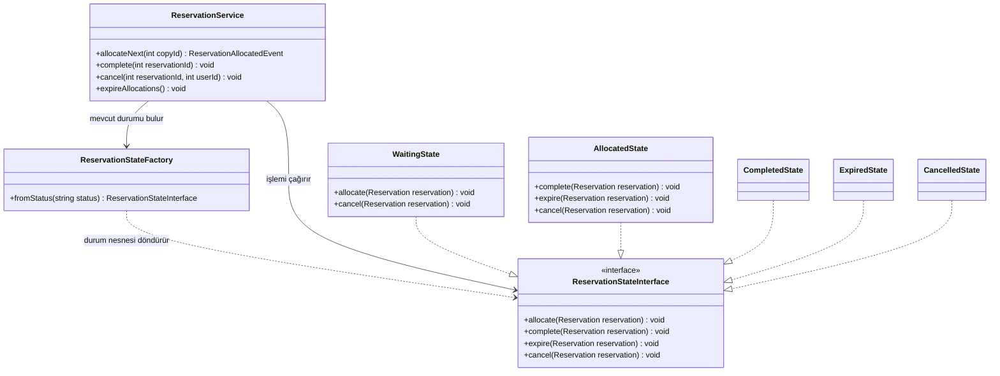

Bütün durum sınıfları arayüzdeki metotları uygulayacaktır. Diyagramda yalnızca izin verilen işlemler ayrıntılı gösterilmiştir; geçersiz işlemler açıklayıcı hata üretecektir. Tamamlandı, süresi doldu ve iptal edildi durumları son durumlar olacaktır.

ReservationStateFactory, kayıtlı durum bilgisinden uygun durum nesnesini oluşturan yardımcı sınıftır. Bu sınıf, ayrıca Factory Method veya Abstract Factory deseni kullandığımız anlamına gelmez.

#### Strategy ile Ceza Hesaplama

FineService, kendisine verilen ceza politikasını kullanır. Her politika gecikme günlerini kendi kuralına göre sayar, günlük ücreti uygular ve sonucu üst sınırla sınırlar.

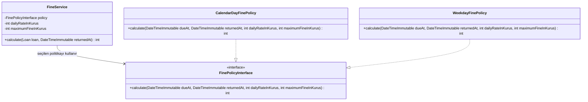

CalendarDayFinePolicy hafta sonları dahil gecikme günlerini sayar. WeekdayFinePolicy cumartesi ve pazar günlerini saymaz. Kullanılacak politika sistem yapılandırmasında SRS'deki kurala göre seçilir; kullanıcı kendi politikasını seçemez. Hesaplanan tutar tam sayı kuruş olarak döndürülür.

#### Observer ile Sistem İçi Bildirim

Bir kopya üyeye başarıyla ayrıldığında ReservationAllocatedEvent olayı oluşturulur. Veri işlemi başarıyla tamamlandıktan sonra EventDispatcher, kayıtlı dinleyicileri çalıştırır.

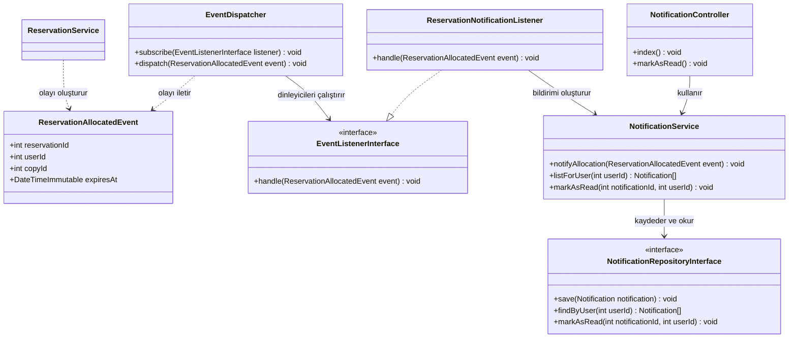

Başlangıçta ReservationNotificationListener, EventDispatcher'a kaydedilecektir. İade veya süre dolması işlemini yöneten servis, başarılı transaction sonrasında oluşan ayırma olaylarını EventDispatcher'a iletecektir. Böylece geri alınmış bir işlem için bildirim oluşturulmayacaktır.

Üye bildirimlerini NotificationController üzerinden görüntüleyecektir. NotificationService, bildirimlerin yalnızca ilgili üye tarafından görüntülenmesini ve okundu olarak işaretlenmesini kontrol edecektir. SMS veya e-posta gönderilmeyecektir.

Bildirim oluşturma başarısız olduğunda hata ve yeniden deneme için gereken olay bilgileri saklanacaktır. Aynı olay tekrar işlendiğinde aynı rezervasyon ayırması için ikinci bir bildirim oluşturulmaması sağlanacaktır.

### Model İlişkilerinin Açıklaması

- Bir kitap birden fazla yazara sahip olabilir; bir yazar birden fazla kitap yazabilir. Bu ilişki veritabanında book_authors ara tablosuyla saklanacaktır.
- Her fiziksel kopya tek bir kitaba aittir. Bir kopyanın zaman içinde birçok ödünç kaydı olabilir; ancak aynı anda yalnızca bir aktif ödünç kaydı bulunabilir.
- Rezervasyon kitap üzerinden oluşturulur. Kopya ayrılana kadar allocatedCopyId, allocatedAt ve expiresAt alanları boş olacaktır. Üç günlük süre, kopyanın ayrıldığı anda başlayacaktır.
- Bir kopya zaman içinde farklı rezervasyonlara ayrılabilir; ancak aynı anda yalnızca bir aktif ayırma bulunabilir.
- returnedAt alanı kitap iade edilene kadar, readAt alanı bildirim okunana kadar boş olacaktır. Bu alanlar uygulamada nullable olarak tanımlanacaktır.
- Gecikme oluşmadığında ödünç kaydına ait ceza bulunmaz. Ceza oluştuğunda yapılan ödemeler ayrı Payment kayıtlarıyla izlenir.
- Payment içindeki recordedBy, ödeme kaydını oluşturan yetkili kullanıcıyı belirtir; ödeme yapan üyeyi değil.
- Para tutarları PHP tarafında yuvarlama hatasını önlemek için tam sayı kuruş olarak taşınacaktır.
- Model sınıfları veri taşır; ceza hesabı, sıra seçimi ve veritabanı erişimi yapmaz.

## 3. Sıralama Diyagramı

### Kitap İadesi ve Sıradaki Üyeye Ayırma

Kütüphaneci iade işlemini başlatır. Sistem yetkiyi ve ödünç kaydını kontrol eder; geçerli işlemde cezayı hesaplar, ödünç kaydını kapatır ve kopyayı rezervasyon sırasındaki ilk uygun üyeye ayırır.

Diyagramdaki Repository katılımcısı, işlemde kullanılan ödünç, kopya, ceza ve rezervasyon Repository uygulamalarını birlikte temsil eder. Transaction işlemleri, aynı veritabanı bağlantısını kullanan bir işlem yöneticisi üzerinden yürütülecektir.

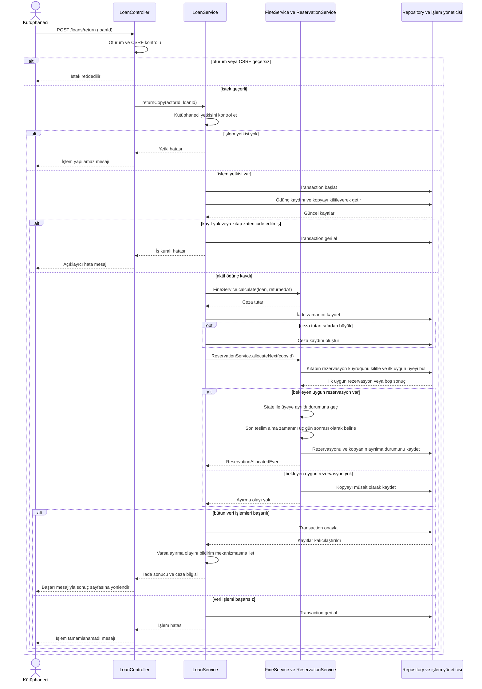

### Ayırma Sonrasında Bildirim Oluşturma

Bu akış yalnızca başarılı transaction sonrasında çalışır. Bildirim oluşturma başarısız olduğunda iade ve kitap ayırma işlemleri geri alınmaz.

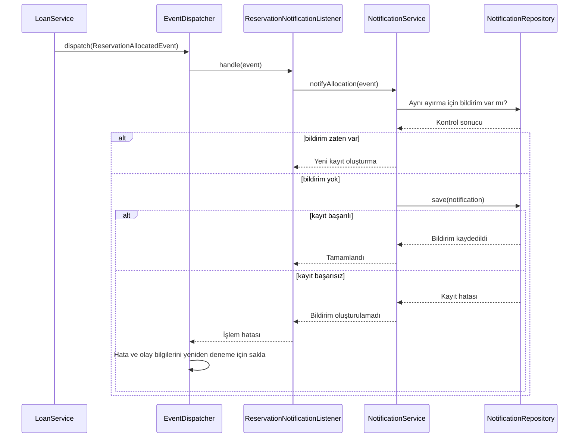

### Akışın İş Kuralları

- İade zamanının tek bir değeri alınır; ödünç kaydı ve ceza hesabında aynı zaman kullanılır.
- İade, ceza kaydı ve kopyanın yeni durumu tek transaction içinde kaydedilir.
- Aynı kitaba ait eşzamanlı işlemler rezervasyon sırasını bozmamalıdır. İlgili kayıtlar tutarlı bir kilitleme sırasıyla işlenir.
- İlk uygun rezervasyon, oluşturulma zamanı ve eşitlik halinde kayıt numarasına göre seçilir.
- Üç günlük süre, kopyanın üyeye ayrıldığı anda başlar.
- Bildirim, veri işlemi başarıyla tamamlandıktan sonra oluşturulur.
- Üye bildirimi sisteme giriş yaptığında görüntüler.

## 4. ER Diyagramı ve Normalizasyon

### Veritabanı Yapısı

Kitap ile fiziksel kopyaları ayrı tablolarda tutulacaktır. Ödünç işlemleri fiziksel kopyaya, rezervasyonlar ise kitaba bağlanacaktır. Rezervasyon için bir kopya ayrıldığında ilgili kopya da rezervasyon kaydına eklenecektir.

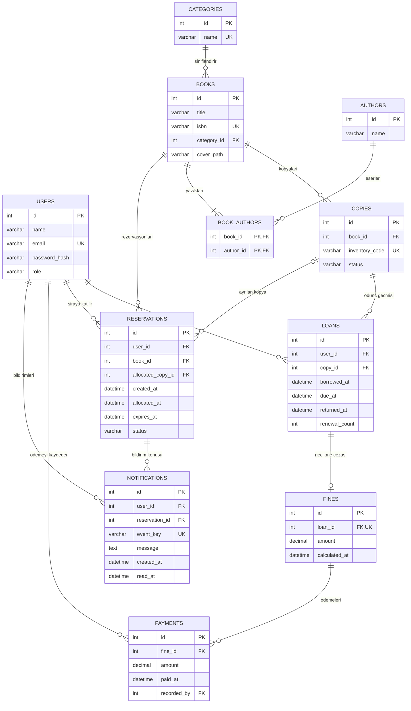

### İlişkilerin Açıklaması

- Bir üyenin birçok ödünç ve rezervasyon kaydı olabilir.
- Bir kitap birçok fiziksel kopyaya sahip olabilir. Her kopya yalnızca bir kitaba aittir.
- Bir kitap birden fazla yazara sahip olabilir. Kitap ve yazar arasındaki çoktan çoğa ilişki BOOK_AUTHORS ara tablosuyla kurulur.
- Her kitap bu tasarımda tek kategoriye bağlıdır; bir kategoride birçok kitap bulunabilir.
- Ödünç kaydı, kitabın genel kaydına değil teslim edilen fiziksel kopyaya bağlanır.
- Rezervasyon başlangıçta yalnızca kitaba bağlıdır. Bir kopya ayrıldığında allocated_copy_id alanı doldurulur.
- Bir ödünç kaydının gecikme cezası olmayabilir; varsa tek bir FINES kaydı bulunur.
- Ödemeler ilgili cezaya bağlanır. recorded_by, ödeme kaydını oluşturan kütüphaneci veya yetkili kullanıcıdır.
- Sistem içi bildirimler ilgili üyeye ve rezervasyona bağlanır. event_key, aynı ayırma olayının tekrar işlenmesi durumunda ikinci bir bildirim oluşmasını engelleyen benzersiz anahtardır.

### Alanlar ve Veri Bütünlüğü Kuralları

- returned_at, kitap iade edilene kadar NULL olacaktır.
- allocated_copy_id, allocated_at ve expires_at, rezervasyona kopya ayrılana kadar NULL olacaktır.
- read_at, bildirim okunana kadar NULL olacaktır.
- Parasal alanlar MySQL'de DECIMAL(10,2) olarak saklanacaktır. PHP'deki tam sayı kuruş değerleri Repository sınırında bu biçime dönüştürülecektir.
- renewal_count yalnızca 0 veya 1 olabilir.
- Son teslim zamanı, ödünç verilme zamanından önce olamaz.
- Bir kopyada aynı anda yalnızca bir aktif ödünç veya aktif rezervasyon ayırması bulunabilir. Bu kural transaction, kilitleme ve uygun veritabanı kısıtlarıyla korunacaktır.
- Rezervasyona ayrılan kopyanın book_id değeri, rezervasyonun book_id değeriyle aynı olmalıdır.
- Bir üye aynı kitap için birden fazla aktif rezervasyon oluşturamaz.
- Ödeme tutarı pozitif olmalı ve toplam ödeme ceza tutarını aşmamalıdır.
- Geçmiş ödünç ve ödeme kayıtları korunacaktır. Bu kayıtlara bağlı kitap, kopya ve kullanıcılar doğrudan silinmeyecek; silme davranışı kısıtlanacak veya kayıtlar pasif hale getirilecektir.
- Rezervasyon sırası created_at ve ardından id alanına göre belirlenecektir.

### 3NF Gerekçesi

Tablolardaki her alan tek bir değer taşıdığı için 1NF sağlanır; bir kitabın yazarları aynı hücrede liste halinde tutulmaz, BOOK_AUTHORS ara tablosuyla ilişkilendirilir.

BOOK_AUTHORS tablosunda birleşik anahtar book_id ve author_id alanlarından oluşur ve anahtarın bir kısmına bağlı yazar adı veya kitap adı gibi ek bilgiler bulunmaz. Diğer tabloların tek alanlı birincil anahtarları bulunduğundan kısmi anahtar bağımlılığı oluşmaz ve 2NF sağlanır.

Kitaplarda kategori adı yerine category_id, kopyalarda kitap adı yerine book_id ve ödünç kayıtlarında üye adı yerine user_id tutulur. Böylece başka bir varlığın bilgileri tekrar edilmez ve 3NF sağlanır. Bildirimdeki user_id ise rezervasyon sahibinden türetilen bir kopya bilgi değil, bildirimin alıcısını ifade eder; mesaj, oluşturulduğu andaki içeriği koruyan bir kayıttır.

Öneri puanları, aktif ödünç sayıları ve kalan ceza borcu ayrı alanlarda tekrar saklanmayacak; ilgili kayıtlar üzerinden hesaplanacaktır.
Aynı fiziksel kopyanın iki üyeye verilmesini önlemek için transaction içinde satır kilidi kullanmayı planladık. Bunun için MySQL’in SELECT ... FOR UPDATE mekanizmasını kullanacağız.”

## 5. Tasarım Desenleri

Projemizde Repository, State, Strategy ve Observer desenlerini kullanmayı planlıyoruz. Her desen, sistemde farklı bir sorumluluğu düzenlemek için seçilmiştir.

### 5.1. Repository Deseni

Kitap, üye, kitap kopyası, ödünç, rezervasyon, ceza ve bildirim kayıtlarını okumak ve kaydetmek için Repository desenini seçtik. Service sınıfları veriye doğrudan erişmek yerine Repository arayüzlerini kullanacak; bu arayüzlerin JSON ve MySQL uygulamaları olacaktır. Alternatif olarak veri okuma ve yazma kodlarını doğrudan Service sınıflarına yerleştirebilirdik. Repository sayesinde veri saklama yöntemi değiştiğinde iş kurallarını yeniden yazmamız gerekmeyecek ve testlerde gerçek veritabanı yerine test amaçlı bir Repository kullanabileceğiz.

Örneğin LoanService, ödünç kaydını LoanRepositoryInterface üzerinden saklayacaktır. Bu arayüzü başlangıçta JsonLoanRepository, MySQL aşamasında ise MySqlLoanRepository uygulayacaktır. Üyenin beş kitap sınırını kontrol etmek LoanService'in, kaydı saklamak Repository'nin görevidir.

### 5.2. State Deseni

Rezervasyonların durumlarını ve her durumda yapılabilecek işlemleri yönetmek için State desenini seçtik. Rezervasyon; bekliyor, üyeye ayrıldı, tamamlandı, süresi doldu veya iptal edildi durumlarında bulunacak ve bu durumlar ReservationStateInterface arayüzünü uygulayan ayrı sınıflarla temsil edilecektir. Alternatif olarak bütün durum kontrollerini ReservationService içinde çok sayıda if veya switch koşuluyla yapabilirdik. State sayesinde durumlara ait kurallar ayrı tutulacak ve iptal edilmiş bir rezervasyonun teslim alınması gibi geçersiz işlemler engellenecektir.

Örneğin WaitingState, bekleyen rezervasyonu; AllocatedState ise bir kopyanın üyeye ayrıldığı rezervasyonu temsil edecektir. Üye ayrılan kitabı teslim aldığında rezervasyon CompletedState durumuna geçecektir. Sıradaki üyeyi seçmek ve üç günlük süreyi kontrol etmek ReservationService'in, mevcut durumda hangi işlemlere izin verildiğini belirlemek durum sınıflarının görevidir.

### 5.3. Strategy Deseni

Gecikme cezasında hafta sonlarının sayılıp sayılmamasına göre farklı hesaplama yöntemlerini desteklemek için Strategy desenini seçtik. FinePolicyInterface arayüzünü uygulayan CalendarDayFinePolicy bütün gecikme günlerini, WeekdayFinePolicy ise yalnızca hafta içindeki gecikme günlerini sayacaktır. Alternatif olarak iki yöntemi tek bir ceza sınıfında koşullu ifadelerle birleştirebilirdik. Strategy sayesinde hesaplama yöntemleri bağımsız olarak test edilecek ve yeni bir politika eklenirken mevcut yöntemlerin kodu değiştirilmeyecektir.

FineService, sistem yapılandırmasında seçilen politikayı kullanarak ceza hesaplatacaktır. Günlük ücret ve ceza üst sınırı hesaplamaya parametre olarak verilecektir. Kullanılacak politika SRS'deki hafta sonu kuralına göre belirlenecek; üyeler kendi ceza yöntemlerini seçemeyecektir.

### 5.4. Observer Deseni

Bir kitap kopyası rezervasyon sırasındaki üyeye ayrıldığında sistem içi bildirim oluşturmak için Observer desenini seçtik. ReservationService, ayırma işlemi başarıyla kaydedildikten sonra ReservationAllocatedEvent olayını yayımlayacak ve bu olayı dinleyen ReservationNotificationListener, NotificationService üzerinden bildirim oluşturacaktır. Alternatif olarak bildirim kodunu doğrudan ReservationService içine yazabilirdik. Observer sayesinde rezervasyon yönetimi ile bildirim oluşturma birbirinden ayrılacak ve bildirim davranışı bağımsız olarak geliştirilebilecektir.

Bildirim, ilgili üyenin hesabına kaydedilecek ve üye sisteme giriş yaptığında kitabın kendisine ayrıldığını ve son teslim alma zamanını görebilecektir. Projede SMS veya e-posta gönderimi yapılmayacaktır. Bildirim oluşturma başarısız olursa kitap ayırma işlemi geri alınmayacak; bildirim hatası kaydedilerek yeniden denenebilecektir.

### Desenlerin Birlikte Çalışması

Bir kitap iade edildiğinde LoanService ödünç kaydını kapatır ve FineService, Strategy ile belirlenen politikaya göre gecikme cezasını hesaplar. ReservationService, uygun kopyayı sıradaki üyeye ayırır ve State yapısıyla rezervasyon durumunu değiştirir. Veri okuma ve yazma işlemleri Repository üzerinden yürütülür. İşlem başarıyla kaydedildikten sonra Observer mekanizması ilgili üyeye sistem içi bildirim oluşturur.

Rezervasyon sırasının belirlenmesi, üç günlük sürenin kontrolü ve kitap önerilerinin hesaplanması ayrıca geliştirilecek iş kuralları ve algoritmalardır. Aynı kopyanın iki kişiye verilmesini engellemek için MySQL aşamasında transaction, satır kilidi ve uygun veritabanı kısıtları kullanılacaktır.
## 6. Sayfa Haritası ve Ekran Taslakları

### 6.1. Sayfa Haritası

Kullanıcı giriş yaptıktan sonra rolüne uygun panele yönlendirilir. Üye kendi işlemlerine erişirken kütüphaneci kitap ve ödünç işlemlerini yönetir. Sistem yöneticisi hesap ve yetki yönetimine erişir.

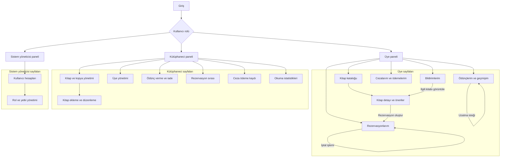

### Erişim Kuralları

- Üye yalnızca kendi ödünç, rezervasyon, ceza ve bildirim kayıtlarına erişebilir.
- Kütüphaneci kitap, kopya ve üye kayıtlarını yönetebilir; ödünç verme, iade ve ceza ödeme kaydı işlemlerini gerçekleştirebilir.
- Sistem yöneticisi kullanıcı hesaplarını ve rollerini yönetebilir.
- Bir sayfanın menüde gizlenmesi yeterli değildir; her istekte sunucu tarafında yetki kontrolü yapılacaktır.
- Ödünç alma ve iade, kitabın fiziksel teslimi sırasında kütüphaneci tarafından sisteme kaydedilecektir.
- Çıkış işlemi oturumu sonlandırır ve kullanıcıyı giriş sayfasına yönlendirir.

### 6.2. Ekran Taslakları

### 6.2. Ekran Taslakları

Ekran taslakları; form alanlarını, düğmeleri, liste sütunlarını ve hata mesajlarının yerlerini göstermektedir. Görsellerdeki kayıtlar örnek verilerdir.

#### Sistem Girişi
Kullanıcı adı ve şifreyle giriş yapılır. Hesabı olmayan kullanıcı Kaydol düğmesiyle kayıt sayfasına geçer.

#### Kitap Kataloğu
Kitaplar aranır, kategoriye göre filtrelenir ve sayfalar halinde listelenir.

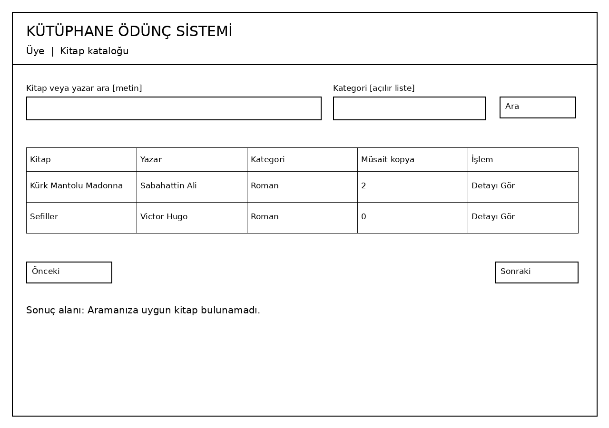

#### Kitap Detayı ve Öneriler
Kitap bilgileri, müsait kopya sayısı, rezervasyon düğmesi ve kitap önerileri gösterilir.

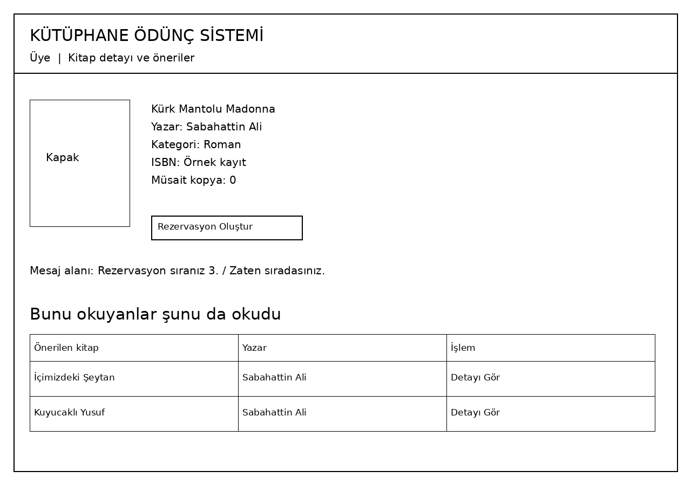

#### Ödünçlerim
Üyenin ödünç aldığı kitaplar, teslim tarihleri ve uzatma durumu gösterilir.

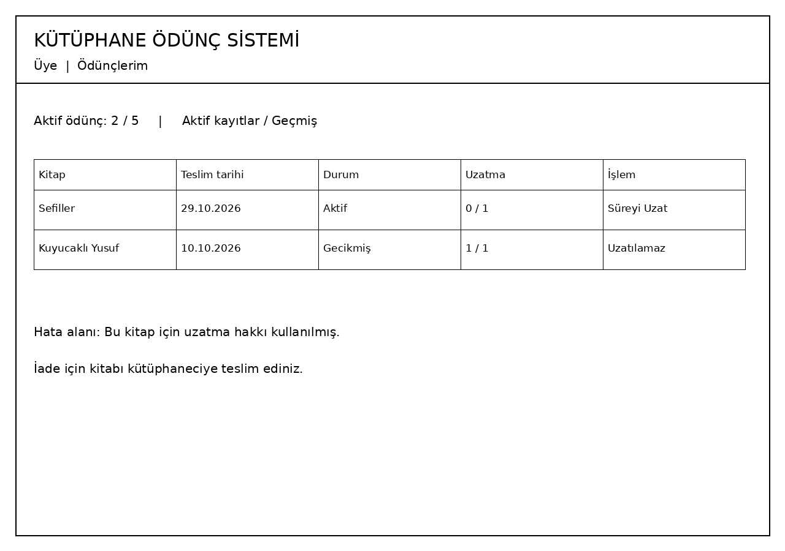

#### Rezervasyon Sırası
Kütüphaneci rezervasyon sırasını, ayrılan kopyayı ve son teslim alma zamanını takip eder.

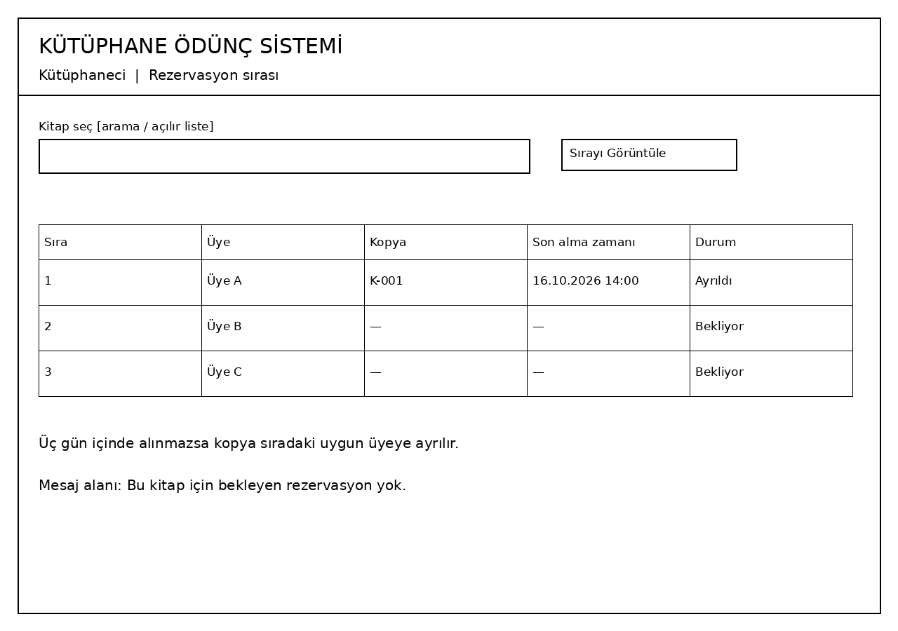

#### Ödünç Verme ve İade
Kütüphaneci ödünç ve iade işlemlerini gerçekleştirir; ceza ve rezervasyon sonuçlarını görüntüler.

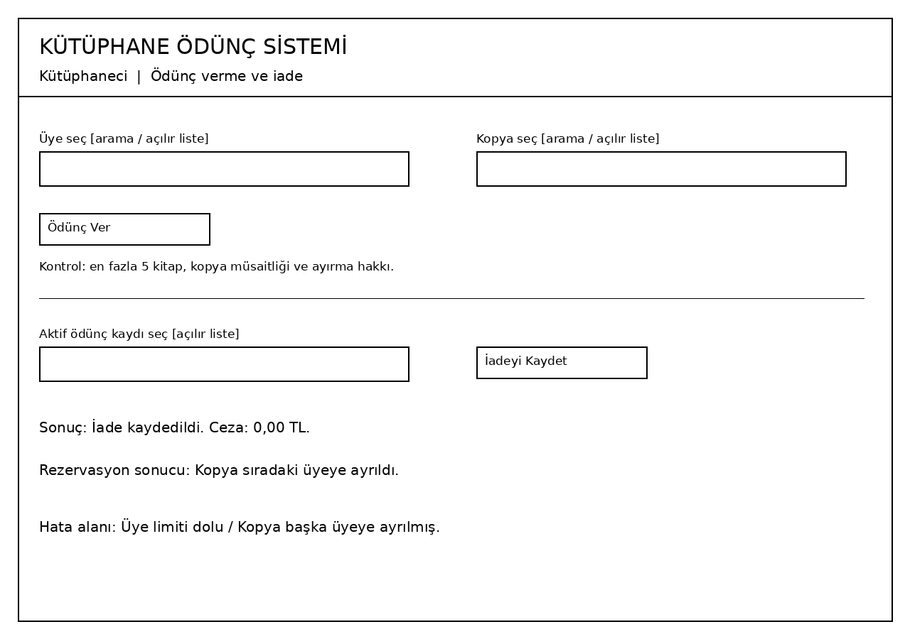

## 7. Riskler ve Önlemler

Riskler; gerçekleşme olasılığı, etkisi ve alınacak önlemler açısından değerlendirilmiştir.

| Risk | Olasılık | Etki | Önlem |
|---|---|---|---|
| Aynı fiziksel kitap kopyasının eşzamanlı işlemler sonucunda birden fazla üyeye ayrılması veya ödünç verilmesi — çekirdek problem | Orta | Yüksek | Kopyanın müsaitliği işlem sırasında kontrol edilecek. MySQL aşamasında transaction ve satır kilidi kullanılacak; eşzamanlı isteklerden yalnızca birinin başarılı olduğu test edilecek. |
| Hatalı veya eksik bilgilerin kayıt sırasında kabul edilmesi | Orta | Orta | Zorunlu alan, veri tipi ve biçim kontrolleri sunucu tarafında uygulanacak. Geçersiz bilgiler kaydedilmeyecek ve kullanıcıya açıklayıcı hata mesajı gösterilecek. |
| Oturum ve yetkilendirme kontrollerinin hatalı çalışması | Düşük | Yüksek | Giriş, çıkış, rol ve kayıt sahipliği kontrolleri farklı kullanıcı hesaplarıyla test edilecek. Üyelerin başka üyelerin kayıtlarına ve yetkili personel işlemlerine erişmesi engellenecek. |
| Performans testlerinin yetersiz kalması nedeniyle yoğun kullanımda sistemin yavaşlaması | Orta | Orta | Sayfalama ve uygun veritabanı indeksleri kullanılacak. Farklı kullanıcı ve istek yükleri altında performans ölçülecek; sonuçlar SRS'deki NFR hedefleriyle karşılaştırılacak. |
| Hatalı giriş denemelerine karşı yeterli güvenlik önlemi bulunmaması | Orta | Yüksek | Tekrarlanan başarısız girişlerde kullanıcı adı ve IP temelinde deneme sınırı ile geçici bekleme uygulanacak. Giriş denemeleri kaydedilecek ve şifreler güvenli hash olarak saklanacak. |
| Ödünç geçmişine göre kitap önerilerinin yanlış oluşturulması — çekirdek problem | Orta | Orta | Ortak okur sayıları benzersiz üyeler üzerinden hesaplanacak. Tekrarlanan ödünçlerin puanı yanlış artırması engellenecek; küçük bir örnek veri kümesinin sonuçları elle hesaplanıp algoritmayla karşılaştırılacak. |

